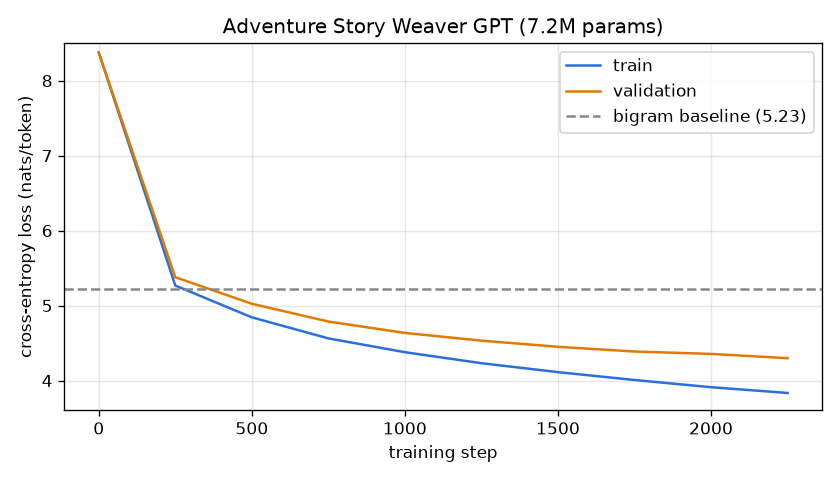

[](https://msrit.ask.thili.ai/b/vqsbzz3tav)
[](https://github.com/Subhash-2910/adventure-story-weaver/actions/workflows/ci.yml)

# Adventure Story Weaver

A small GPT language model built **from scratch** (no pretrained weights, no Hugging Face, no LLM API) and trained on
eight public domain adventure novels. You give it the opening of a scene and it writes the next part of the story,
in the style of Stevenson, Haggard, Burroughs, Conan Doyle and Verne.

```
$ python -m app.cli generate "The cave mouth was black, and from somewhere deep inside it came" --seed 1
The cave mouth was black, and from somewhere deep inside it came inwards. The windows
were rowing out of a little pilters, but it was a most beautiful and unexpected nightly
interested by the sunlight and bright and the furnished. But now, I began to be thought
so that it appeared all that she had been able to be, and I went on towards us with a
huge dirty light, which appeared to grow more and darker than in time for it was nobody
but my father's name.

"Go! Hast thou, man," he said, "and so I do not tell you that the little chance.
```

Everything in the pipeline is in this repository: corpus cleaning → byte-pair tokenizer → embeddings →
causal self-attention → transformer → training loop → sampling → command-line interface.

## Quick start (one command after setup)

You need Python 3.12 and git. A trained model (`checkpoints/model.pt`, about 17 MB, stored in half precision) is committed, so you can generate
stories straight away. No API keys and no `.env` file are needed.

```bash
git clone https://github.com/Subhash-2910/adventure-story-weaver.git
cd adventure-story-weaver
python3.12 -m venv .venv && source .venv/bin/activate
pip install -r requirements.txt

python -m app.cli generate "The cave mouth was black, and"      # <- the one command
```

Or, with Docker only (no Python setup needed):

```bash
docker build -t story-weaver .
docker run --rm story-weaver generate "When the sun rose over the desert, we saw"
docker run --rm -it story-weaver play
```

## Using the CLI

| Command | What it does |
|---|---|
| `python -m app.cli generate "PROMPT"` | Continue a prompt. Options: `--length 200`, `--temperature 0.6` (alias `--creativity`), `--top-k`, `--top-p`, `--repetition-penalty`, `--seed 1`, `-n 3` for three alternatives, `--mark` to show where your prompt ends |
| `python -m app.cli play` | Interactive mode: type a line, the model writes the next segment. `/more` continues, `/temp 1.0`, `/length 200`, `/save NAME`, `/show`, `/new`, `/quit` |
| `python -m app.cli story new NAME "opening line"` | Start a saved story (kept in `stories/stories.json`) |
| `python -m app.cli story continue NAME ["your next line"]` | Load it, optionally add your own line, generate the next segment, save again |
| `python -m app.cli story show/list/export/delete ...` | Read, list, export to `.txt`, or delete saved stories |
| `python -m app.cli tokenize "some text"` | See how the BPE tokenizer splits text |
| `python -m app.cli corpus` | Re-download and clean the books (milestone 1) |
| `python -m app.cli train` | Retrain the model (milestone 4). `--quick` trains a tiny model in about 2 minutes |
| `python -m app.cli evaluate` | Compare the GPT with a bigram baseline; writes `results/metrics.json` and `results/samples.md` |

Example of a longer story built segment by segment:

```bash
python -m app.cli story new jungle "We left the boats at the edge of the jungle." --seed 3
python -m app.cli story continue jungle "Suddenly a spear flew past my head." --seed 4
python -m app.cli story show jungle
```

## How it works (the milestones)

| # | Milestone | Code | Tests |
|---|---|---|---|
| 1 | Corpus of public domain adventure novels | [app/corpus.py](app/corpus.py) | `test_milestone_1_*` |
| 2 | Byte-pair tokenizer + token/position embeddings | [app/tokenizer.py](app/tokenizer.py), [app/embeddings.py](app/embeddings.py) | `test_milestone_2_*` |
| 3 | Causal self-attention + transformer block + GPT | [app/model.py](app/model.py) | `test_milestone_3_*` |
| 4 | Training loop | [app/train.py](app/train.py), baseline in [app/baseline.py](app/baseline.py) | `test_milestone_4_*` |
| 5 | Text generation with sampling | [app/generate.py](app/generate.py) | `test_milestone_5_*` |
| 6 | Command-line interface | [app/cli.py](app/cli.py) | `test_milestone_6_*` |

[app/core.py](app/core.py) has one short entry point per milestone (`milestone_1()` … `milestone_6()`) that calls into
these modules.

**1. Corpus.** Eight novels from Project Gutenberg (public domain in the US): *Treasure Island*, *Kidnapped*,
*King Solomon's Mines*, *Allan Quatermain*, *A Princess of Mars*, *The Gods of Mars*, *The Lost World* and
*A Journey to the Centre of the Earth*. The cleaner removes the Gutenberg licence text, title pages, tables of contents,
chapter headings and illustration tags. It also replaces curly quotes and dashes with plain ones and rejoins the
hard-wrapped lines into paragraphs. Result: [data/corpus.txt](data/corpus.txt), **641,923 words, 3.47 MB**.

**2. Tokenizer and embeddings.** A byte-level BPE tokenizer, written from scratch. It starts from the 256 byte values,
so any text can be encoded, then learns 3,840 merges to reach a vocabulary of 4,096. The text is split GPT-2-style
first, so merges never cross word boundaries. Training takes about 3 seconds thanks to incremental pair counts. The
whole corpus becomes **937,480 tokens (3.7 characters per token)**. Common words become single tokens: `The | pir |
ates | buried | their | treasure | .`. Each token id is turned into a 288-dimensional vector, and a learned position
vector is added to it.

**3. Model.** A decoder-only transformer: 6 blocks, 6 attention heads, 288-dimensional embeddings and a 128-token
context, **7.2M parameters**. Attention is written out explicitly as `softmax(QKᵀ/√d + mask)·V`, with a lower-triangular
mask so each token can only see earlier tokens. Each block is pre-LayerNorm with residual connections: attention, then a
4× GELU MLP. The output layer shares its weights with the token embedding (weight tying).

**4. Training.** Next-token prediction with cross-entropy, AdamW (weight decay 0.1 on weight matrices only), 200 warmup
steps then cosine decay from 6e-4 to 6e-5, gradient clipping at 1.0 and dropout 0.2. Batches are 32 × 128 tokens.
The last 10% of the corpus is held out for validation, and the checkpoint with the lowest validation loss is the one
kept. The run in this repo trained for **2,250 steps (~10 minutes on an Apple M3 GPU, about 9.2M tokens, roughly 11 epochs)** and was then stopped because of a time limit; validation loss was still falling slowly, so a longer run would do a bit better.

**5. Generation.** Autoregressive sampling: temperature scaling, a repetition penalty over the last 64 tokens, top-k (50)
and nucleus/top-p (0.95) filtering. The context slides once it is longer than 128 tokens. By default it keeps going
for up to 40 extra tokens so the output ends at the end of a sentence. `--seed` makes the output reproducible.

**6. CLI.** `argparse` subcommands for one-shot generation, an interactive mode and saved multi-segment stories (see
the table above). All the stretch ideas are included: adjustable length and creativity, and saving and loading stories
to build longer narratives.

## Results

All numbers come from `python -m app.cli evaluate` ([results/metrics.json](results/metrics.json)) on the **held-out
validation split** (93,748 tokens the model never trained on). Loss is cross-entropy in nats per token; lower is
better.

| Model | Validation loss | Perplexity |
|---|---|---|
| Uniform guess over 4,096 tokens | 8.318 | 4,096 |
| Bigram baseline (next token from the current token only, add-0.1 smoothing) | 5.226 | 186.0 |
| **This GPT (7.2M params, 2,250 steps)** | **4.306** | **74.1** |

The GPT cuts perplexity by **60%** relative to the bigram baseline: on average it is choosing among ~74 plausible
next tokens instead of ~186. Copy check: across the 15 evaluation samples, **0%** of 8-word sequences appear
word-for-word in the training corpus, so the model is composing new sentences rather than reciting the books.

Training curve ([checkpoints/train_log.json](checkpoints/train_log.json), full console output in
[results/train_output.txt](results/train_output.txt)):



### Sample outputs

More samples at three temperatures, plus bigram baseline samples, are in [results/samples.md](results/samples.md).

Temperature 0.5, seed 7 (copied from [results/samples.md](results/samples.md)):

> **Captain Hawk unrolled the old map on the table and pointed at** the same time to the other.
> "Well," said he, "that's what you would be a man?"
> "Ay, sir," says I; "but if ye're not the name of this here."
> "The captain," cried Silver, "I'm a good-coat, and that'll have to keep your part, and I am sure enough for the men, and I'll take the lot for my mind."

> **I drew my sword and stepped towards the strange green warrior,** and I saw that he was dead.
> "You are a man of Helium," she said; "but it is the one who can be killed in the outer world's palace to Issus."
> The boy sprang toward the platform.

The bigram baseline on the same prompt, for contrast:

> **When the sun rose over the desert, we saw** that we arena old Umslopogaas conceivel, so, or the unisc. As our position gi fro set.

Notice that the GPT picks up the *register* of the prompt: a sword and a green warrior pull it into Burroughs' Mars
(Helium, Issus), a captain and a map into *Treasure Island* (Silver, "Ay, sir").

## Limits (please read)

* **It is a tiny model trained on a tiny corpus.** 7.2M parameters and ~0.9M tokens (GPT-2 small has 124M parameters
  and was trained on ~9B tokens). Sentences are mostly grammatical and in period style, but the plot does not hold
  together across more than a sentence or two, and some made-up words appear ("girket", "luest").
* **Short memory.** The model sees only the last 128 tokens (~95 words). In long saved stories it forgets earlier
  events and names.
* **Not instruction-following.** It continues text; it does not answer questions or obey "write a story about X".
  Write the *opening of a scene* as your prompt.
* **Inherits the books' style and attitudes.** The sources are 1880s-1910s novels and contain colonial-era
  stereotypes and dated language; the model can reproduce them. Review output before using it in a game.
* **Training was cut short** (2,250 of a planned 5,000 steps) because of time; the validation loss was still going
  down. Run `python -m app.cli train` for the full schedule.
* Temperature above ~1.0 quickly produces nonsense words; below ~0.4 it starts repeating itself.

## Tests

```bash
pytest
```

There are 22 tests: one group per milestone, an evaluation test and two starter smoke tests. They use a tiny made-up story and a tiny model,
so the whole suite runs in a few seconds on CPU. Among other things, they check that:

* the cleaner strips the licence, headings and odd characters;
* BPE is lossless, compresses the text and handles unseen text;
* attention is truly causal (changing a later token does not change earlier outputs);
* training lowers the loss and beats the bigram baseline;
* top-k, top-p and the repetition penalty behave correctly, and seeded generation is reproducible;
* every CLI command works, including an interactive session and saving and continuing a story.

GitHub Actions runs the tests and a real `generate` call with the committed model on every push.

## Retraining from scratch

```bash
python -m app.cli corpus      # downloads the 8 books into data/raw/ and rebuilds data/corpus.txt
python -m app.cli train       # 5,000 steps, about 25 min on an Apple M3 (GPU via MPS); also works on CUDA or CPU (slower)
python -m app.cli evaluate    # refreshes results/metrics.json and results/samples.md
```

Want a different style? Edit the `BOOKS` list in [app/corpus.py](app/corpus.py) (any Gutenberg ids), then run the
three commands above.

## Project layout

```
app/        corpus.py tokenizer.py embeddings.py model.py train.py generate.py baseline.py evaluate.py cli.py core.py storage.py
data/       corpus.txt (cleaned training text)
checkpoints/ tokenizer.json model.pt train_log.json
results/    metrics.json samples.md loss_curve.png train_output.txt
tests/      test_core.py (milestones) test_smoke.py
```

## Credits

The book texts are from [Project Gutenberg](https://www.gutenberg.org) and are in the public domain in the US. The
model design follows the GPT-2 paper (Radford et al., 2019) and the "Attention Is All You Need" paper
(Vaswani et al., 2017).
